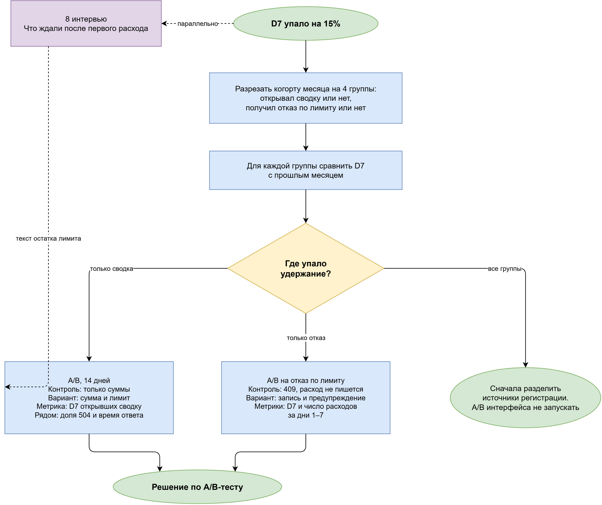

# Продуктовые метрики Ledger

## Часть 1. Продукт

**Название.** Ledger, учёт личных расходов по категориям.

**Ценность.** Человек задаёт лимит на категорию и видит, сколько уже потратил, пока месяц ещё не закончился. Решение «можно ли ещё потратить» принимается по цифре в категории, а не по памяти.

**Бизнес-модель.** Фримиум-подписка. Бесплатно доступны бюджет и список расходов. Подписка открывает сводку за выбранный период и историю старше текущего месяца. Деньги приходят от тех, кто уже ведёт категории и хочет смотреть их пачкой, а не от показа рекламы.

**Аудитория.** Взрослые 20–40 лет, которые сами записывают траты по категориям вроде «еда», «транспорт», «жильё» и держат на них месячный лимит. Это один человек или пара с общим бюджетом. Бухгалтерия компаний и люди, которым нужен только банковский баланс, в аудиторию не входят.

## Часть 2. Цели и метрики AARRR

| Этап                      | Бизнес-цель                                                                          | Ключевая метрика                                                                                                                                           | Почему эта метрика и как её измерять                                                                                                                                                                                |
| ------------------------- | ------------------------------------------------------------------------------------ | ---------------------------------------------------------------------------------------------------------------------------------------------------------- | ------------------------------------------------------------------------------------------------------------------------------------------------------------------------------------------------------------------- |
| Acquisition (Привлечение) | Привести людей, которые уже делят траты на категории и готовы записать первый расход | 1. Новые регистрации за неделю. 2. Доля регистраций с источником «прямой заход» или «приглашение», без платной рекламы                                    | Объём регистраций показывает, растёт ли верх воронки. Доля без рекламы показывает, приходят ли люди из-за самого учёта. Событие `signup`, поле `source`.                                                            |
| Activation (Активация)    | Пользователь отслеживает расход на фоне своего лимита                                | 1. Доля новых пользователей, которые за 24 часа создали бюджет и внесли расход в ту же категорию. 2. Медианное время от регистрации до этой пары действий | События `set_budget` и `add_transaction` с одной и той же `category` внутри 24 часов от `signup`. Медиана считается только по тем, кто сделал пару «лимит + расход в той же категории»                              |
| Retention (Удержание)     | Запись расходов становится еженедельным действием                                    | 1. Удержание на 7-й день: активированный пользователь вернулся и внёс расход. 2. Число расходов на такого пользователя за дни 1–7                         | День 7 отделяет тех, кто попробовал форму, от тех, кто ведёт учёт. Частота за неделю показывает, что лимит обновляется новыми тратами. Когорта по дате активации, событие `add_transaction` в календарный день 7    |
| Revenue (Доход)           | Регулярная сверка с лимитом переходит в оплату сводки и длинной истории              | 1. Конверсия из активированных в платную подписку за 30 дней. 2. MRR                                                                                      | Подписка продаёт сводку и историю тех же категорий. Конверсия связывает бесплатный учёт с оплатой. MRR показывает, держится ли эта оплата. Событие `payment_succeeded`, сумма активных подписок на конец месяца     |
| Referral (Поделиться)     | Пользователь зовёт того, с кем делит бюджет                                          | 1. Приглашения на одного платящего пользователя в месяц. 2. Доля новых регистраций с `referrer_id`                                                        | Общий бюджет естественнее всего передать второму человеку в паре. Приглашение дешевле рекламного привлечения и приводит человека в тот же сценарий категорий. Событие `invite_sent` и поле `referrer_id` у `signup` |

Все метрики в таблице количественные: их можно посчитать по событиям. 

После активации можно один раз спросить: «Понятно ли, сколько осталось до лимита?». Человек отвечает «да» или «нет» и при желании дописывает фразу своими словами. По ответу видно, прочитал ли он остаток так, как задумано. Долю активации по-прежнему считают по бюджету и расходу.

### Как понятно, что пользователь активировался

Активация наступает в момент, когда у категории есть лимит и в ней лежит хотя бы один расход. Это происходит в первые 24 часа после регистрации.

Aha-момент наступает, когда человек видит эту пару вместе: лимит 5000 по «еде» и расход 450 в той же категории. До этого Ledger выглядит как форма. После этого видно, что лимит ещё не выбран и куда ушла сумма.

Одного бюджета без расхода недостаточно: сравнивать нечего. Одного расхода без лимита недостаточно: сумма ни к чему не привязана.

### North Star Metric

Северная звезда: **число расходов за неделю, внесённых в категорию, где уже задан лимит.**

Это одно действие, в котором собрана ценность продукта. Рост метрики при той же базе пользователей означает, что люди продолжают сверять траты с лимитом. Падение означает, что учёт остановился, даже если регистрации и оплаты за прошлый месяц ещё выглядят нормально.

### Связь с бизнес-моделью

Бесплатный контур доводит человека до северной звезды: бюджет и расходы. Платный контур продаёт сводку этих же расходов за период и историю старше месяца. Привлечение без активации не создаёт повод платить. Активация без удержания даёт одну запись и не создаёт историю, за которую платят. Приглашение имеет смысл после того, как первый человек уже ведёт категории: второй приходит в тот же бюджет, а не в пустое приложение.

## Часть 3. Сценарий А

За последний месяц удержание на 7-й день упало на 15%. Активация в этой задаче не менялась: люди по-прежнему создают бюджет и первый расход. Теряется возврат на седьмой день.

### Возможные причины

1. Сводка за период отдаёт только суммы по категориям и не показывает лимит. После первого отчёта человек не видит, сколько осталось, и на седьмой день ему не за чем открывать Ledger.
2. При превышении лимита `AddTransaction` возвращает `budget exceeded` и не сохраняет расход. Человек, который упёрся в лимит в первые дни, не может записать следующую трату и перестаёт открывать приложение.
3. Повторный запрос сводки упирается в таймаут и приходит с кодом 504. Второй визит заканчивается ошибкой, хотя первый расход сохранился.
4. Состав новых пользователей сместился в сторону тех, кто завёл бюджет один раз под короткий повод и не собирался записывать траты на следующей неделе. Продукт для них отработал в первый день, седьмой день в их сценарии не входил.

### Гипотезы

Мы считаем, что падение удержания на 7-й день на 15% связано с тем, что сводка показывает сумму категории и не показывает лимит. Если рядом с суммой появится остаток до лимита, удержание на 7-й день у пользователей, открывших отчёт в первую неделю, вырастет на 5 процентных пунктов.

Мы считаем, что падение удержания на 7-й день связано с отказом записать расход при превышении лимита. Если вместо отказа сохранять расход и показывать предупреждение, что лимит превышен, удержание на 7-й день у тех, кто получил этот отказ в первые 3 дня, вырастет на 8 процентных пунктов.

### Как проверить

Сначала разрезать уже собранную когорту последнего месяца на четыре группы: открывал сводку или нет, получал отказ по лимиту или нет. Для каждой группы посчитать удержание на 7-й день и сравнить с предыдущим месяцем. Падение только у тех, кто открывал сводку, поддерживает первую гипотезу. Падение только у тех, кто получил отказ по лимиту, поддерживает вторую. Падение во всех группах сразу указывает на смену состава аудитории, и тогда A/B-тест интерфейса не нужен, пока не разделены источники регистрации.

Первую гипотезу проверять A/B-тестом 14 дней, половина новых пользователей в каждой группе. Контроль видит текущую сводку, суммы по категориям. Вариант видит сумму и лимит категории. Основная метрика: удержание на 7-й день среди тех, кто открыл сводку. Рядом смотреть долю ответов 504 и время ответа сводки, чтобы не принять таймаут за эффект интерфейса.

Вторую гипотезу проверять отдельным A/B-тестом на тех, кто в первые 3 дня пытается записать расход сверх лимита. Контроль получает нынешний отказ без записи. Вариант сохраняет расход и видит предупреждение. Метрики: удержание на 7-й день в этой группе и число расходов на пользователя за дни 1–7.

Параллельно провести 8 интервью с людьми, которые активировались и не вернулись на 7-й день. Вопрос один: что они ожидали увидеть после первого расхода. Интервью нужно, чтобы сформулировать текст остатка лимита. Решение, подтвердилась ли гипотеза, принимается по A/B-тесту, не по интервью.

