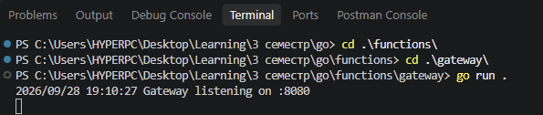
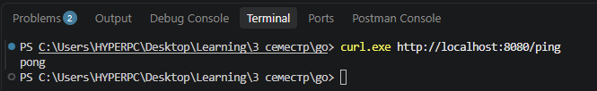
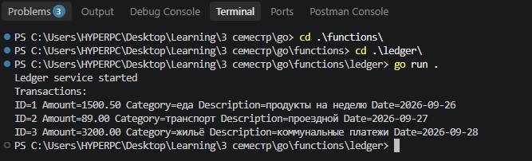
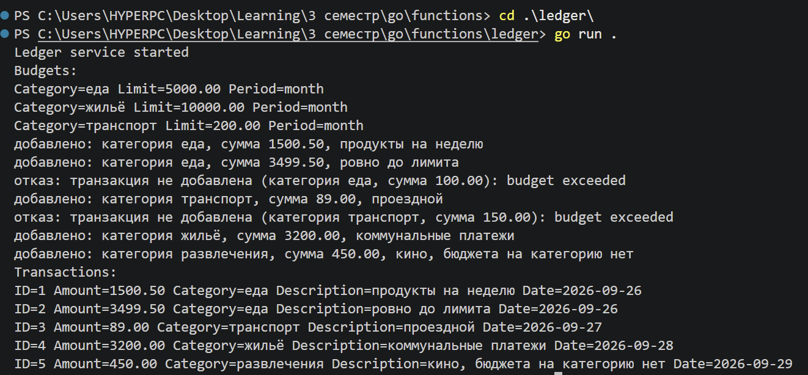

# Домашнее задание 2

Проект состоит из двух отдельных Go-модулей.

## Gateway

HTTP-шлюз. `GET /ping` отвечает `pong` со статусом 200.

```powershell
cd functions/gateway
go run .
```

Прослушиватель `http://localhost:8080`.



Проверка:

```powershell
curl.exe http://localhost:8080/ping
```

Ожидаемый ответ: `pong`.



## Ledger

Бизнес-логика (финансовые транзакции).

```powershell
cd functions/ledger
go run .
```



# Домашнее задание 3

В сервисе Ledger бюджеты хранятся в map[string]Budget и проверяются в AddTransaction до записи транзакции.

Budget содержит **Category**, **Limit** и **Period**. Лимит действует на всю категорию: **Period** сохраняется, а сумма сравнивается с Limit без разбиения по месяцу или году. **SetBudget** добавляет или обновляет запись. **LoadBudgets** читает JSON-массив, при ошибке чтения возвращает read budgets: ..., при ошибке разбора — parse budgets: ..., и только после проверки всех элементов вызывает **SetBudget**.

Если для категории бюджет задан и текущая сумма транзакций вместе с новой превышает **Limit**, **AddTransaction** возвращает budget exceeded и ничего не записывает. Сумма, равная лимиту, проходит. Категория без бюджета не ограничивается.



# Домашнее задание 4

Проверка полей в Ledger вынесена в интерфейс `Validatable` с методом `Validate() error`. Его реализуют `Transaction` и `Budget`. Функция `CheckValid(v Validatable) error` вызывает `Validate` и возвращает результат. Сами методы `Validate` ничего не печатают: сообщение об отказе выводит вызывающий код.

`Transaction.Validate` возвращает ошибку, если `Amount` равен 0 (`transaction amount must not be zero`), если `Amount` отрицательный (`transaction amount must not be negative`) или если `Category` пустая (`transaction category must not be empty`). Формат `Date` не проверяется: поле строковое.

`Budget.Validate` возвращает ошибку, если `Limit` не положительный (`budget limit must be positive`) или если `Category` пустая (`budget category must not be empty`).

`AddTransaction` вызывает `Validate` до проверки лимита и до записи в срез. `SetBudget` вызывает `Validate` и при ошибке не меняет `map`. `LoadBudgets` сначала проверяет каждый элемент JSON-массива и только потом вызывает `SetBudget`, поэтому одна неверная запись не сохраняет остальные.

В `main` одна и та же `CheckValid` получает и `Transaction`, и `Budget`. Корректные значения проходят. Нулевая и отрицательная сумма, пустая категория и неположительный лимит возвращают ошибку. Попытка записать такой бюджет не затирает уже загруженные лимиты: «еда» остаётся 5000, «транспорт» 200, «жильё» 10000. Транзакции с нулевой суммой, отрицательной суммой и пустой категорией в итоговый список не попадают. В списке остаются пять транзакций, принятых раньше по правилам бюджета.