# Домашнее задание 2

Проект состоит из двух отдельных Go-модулей.

## Gateway

HTTP-шлюз. `GET /ping` отвечает `pong` со статусом 200.

```powershell
cd functions/gateway
go run .
```

Прослушиватель `http://localhost:8080`.


Проверка:

```powershell
curl.exe http://localhost:8080/ping
```

Ожидаемый ответ: `pong`.


## Ledger

Бизнес-логика (финансовые транзакции).

```powershell
cd functions/ledger
go run ./cmd/ledger
```


# Домашнее задание 3

В сервисе Ledger бюджеты хранятся в map[string]Budget и проверяются в AddTransaction до записи транзакции.

Budget содержит **Category**, **Limit** и **Period**. Лимит действует на всю категорию: **Period** сохраняется, а сумма сравнивается с Limit без разбиения по месяцу или году. **SetBudget** добавляет или обновляет запись. **LoadBudgets** читает JSON-массив, при ошибке чтения возвращает read budgets: ..., при ошибке разбора — parse budgets: ..., и только после проверки всех элементов вызывает **SetBudget**.

Если для категории бюджет задан и текущая сумма транзакций вместе с новой превышает **Limit**, **AddTransaction** возвращает budget exceeded и ничего не записывает. Сумма, равная лимиту, проходит. Категория без бюджета не ограничивается.


# Домашнее задание 4

Проверка полей в Ledger вынесена в интерфейс `Validatable` с методом `Validate() error`. Его реализуют `Transaction` и `Budget`. Функция `CheckValid(v Validatable) error` вызывает `Validate` и возвращает результат. Сами методы `Validate` ничего не печатают: сообщение об отказе выводит вызывающий код.

`Transaction.Validate` возвращает ошибку, если `Amount` равен 0 (`transaction amount must not be zero`), если `Amount` отрицательный (`transaction amount must not be negative`) или если `Category` пустая (`transaction category must not be empty`). Формат `Date` не проверяется: поле строковое.

`Budget.Validate` возвращает ошибку, если `Limit` не положительный (`budget limit must be positive`) или если `Category` пустая (`budget category must not be empty`).

`AddTransaction` вызывает `Validate` до проверки лимита и до записи в срез. `SetBudget` вызывает `Validate` и при ошибке не меняет `map`. `LoadBudgets` сначала проверяет каждый элемент JSON-массива и только потом вызывает `SetBudget`, поэтому одна неверная запись не сохраняет остальные.

В `main` одна и та же `CheckValid` получает и `Transaction`, и `Budget`. Корректные значения проходят. Нулевая и отрицательная сумма, пустая категория и неположительный лимит возвращают ошибку. Попытка записать такой бюджет не затирает уже загруженные лимиты: «еда» остаётся 5000, «транспорт» 200, «жильё» 10000. Транзакции с нулевой суммой, отрицательной суммой и пустой категорией в итоговый список не попадают. В списке остаются пять транзакций, принятых раньше по правилам бюджета.

# Домашнее задание 5

Gateway импортирует модуль ledger и отдаёт HTTP API на порту `:8080`. `POST` создаёт запись и возвращает `201`, `GET` возвращает `200`. Пустой список приходит как `[]`. Неверные данные дают `400` и `{"error":"..."}`, превышение бюджета — `409` и `{"error":"budget exceeded"}`. Ответы `/api` идут с заголовком `Content-Type: application/json; charset=utf-8`.

Проверка выполнена на `127.0.0.1:8080`: адрес `0.0.0.0:8080` в этот момент занимал Docker.

Запуск и журнал запросов:

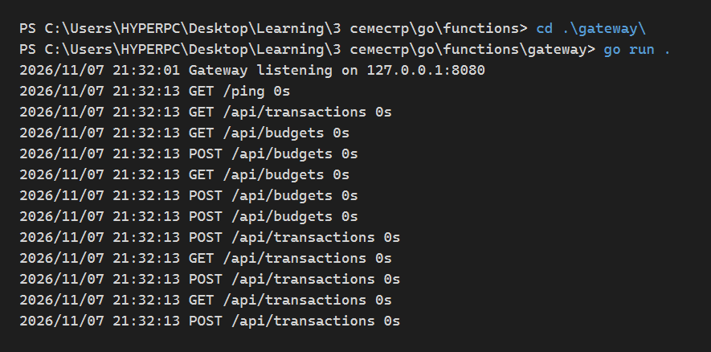

Бюджеты: пустые списки, создание, повторное чтение, нулевой лимит и неверный JSON.

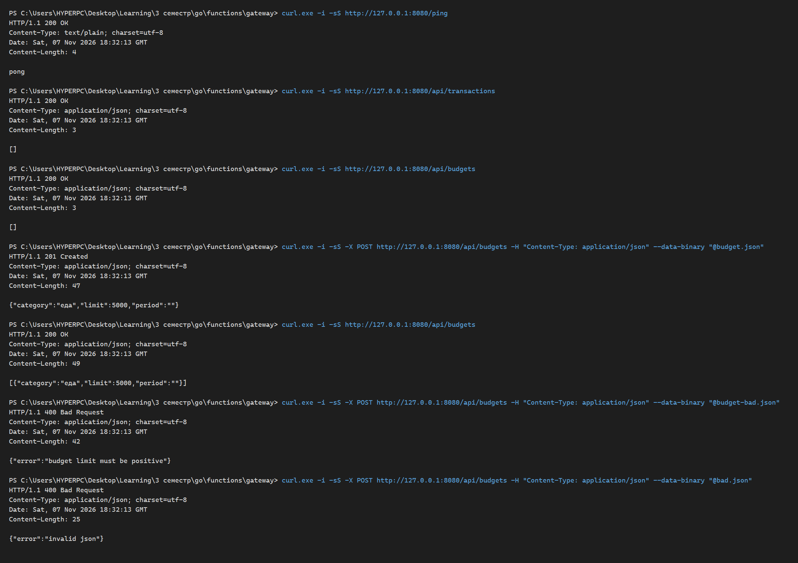

Транзакции: создание, список, отказ при превышении лимита без записи и неверный JSON.

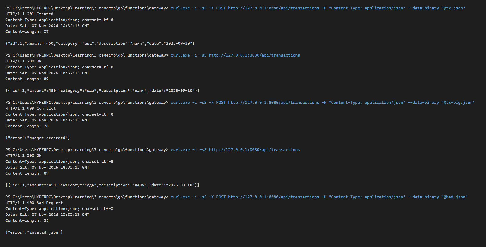

# Домашнее задание 6

`Reset()` очищает транзакции и бюджеты перед сценарием. `Validate` для `Transaction` и `Budget` проверяется таблицей случаев. Транзакция сверх лимита возвращает `budget exceeded` и не попадает в `ListTransactions`. HTTP-проверки разложены по `t.Run`: `ok`, `exceeded`, `bad_json`, `bad_limit`. `t.Parallel()` стоит только на проверках `Validate`, без общего хранилища.

```powershell
go test ./... -v -cover -coverprofile=cover.out
go tool cover -func=cover.out
```

Ledger. Покрытие пакета `ledger` — 65.0%, по модулю вместе с `cmd/ledger` — 41.9%.

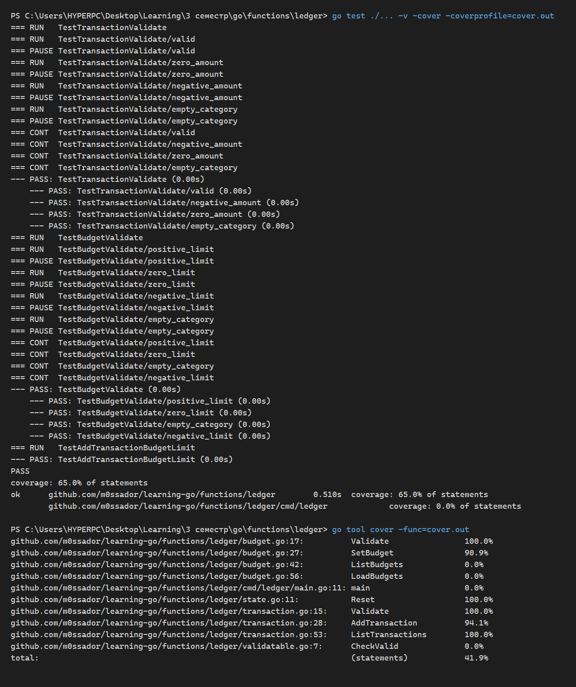

Gateway. Покрытие `internal/api` — 82.0%, по модулю вместе с `main` — 63.3%.

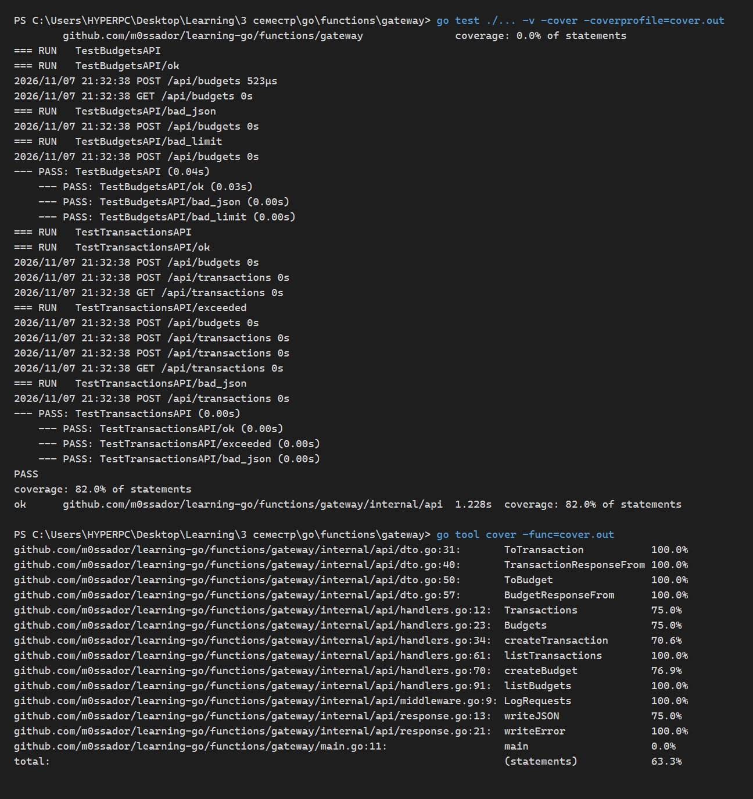

# Домашнее задание 7

Ledger пишет бюджеты и расходы в PostgreSQL. 

Миграции Goose лежат в `functions/ledger/migrations`: таблицы `budgets` и `expenses`. 

Подключение идёт через `sql.Open("pgx", dsn)` и `Ping`. 

Строка берётся из `DATABASE_URL`, иначе из `DB_HOST`, `DB_PORT`, `DB_USER`, `DB_PASS` и `DB_NAME`. 

По умолчанию база `cashapp` на `localhost:5432`, пользователь `postgres`, `sslmode=disable`. 

Пул: 10 открытых соединений, 5 простаивающих, время жизни соединения 30 минут.

`SetBudget` делает upsert по категории. `AddTransaction` сначала вызывает `Validate`, затем сверяет сумму расходов с лимитом. Если сумма больше лимита, возвращается `budget exceeded` и строка не вставляется. `GetReportSummary` кладёт итог в Redis на 30 секунд, ключ `report:summary:<from>:<to>`. Список бюджетов кэшируется ключом `budgets:all` на 30 секунд и сбрасывается после успешного `SetBudget`.

Миграция вниз и вверх, версия базы 1:

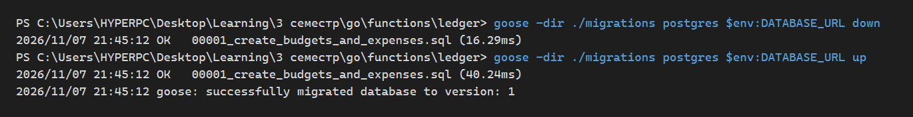

Запуск Gateway. В журнале есть подключение к PostgreSQL и Redis, затем `cache miss` и `cache hit` для одного и того же отчёта:

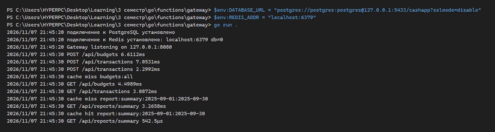

Бюджет `еда` 5000, расход 450, отказ `409` на сумму сверх лимита:

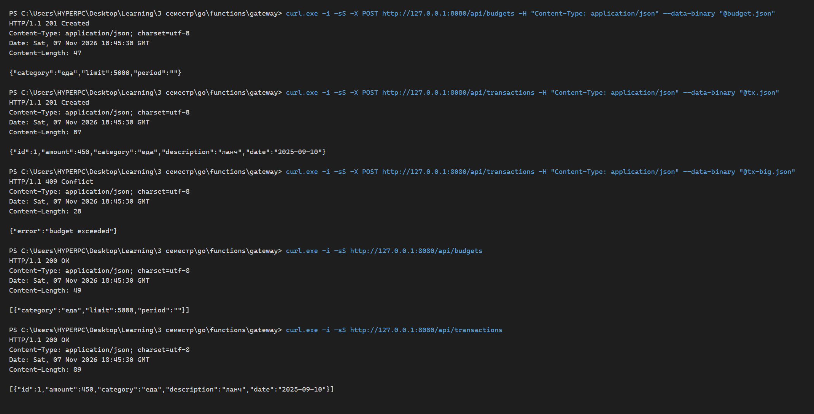

Два одинаковых запроса `GET /api/reports/summary?from=2025-09-01&to=2025-09-30`. 

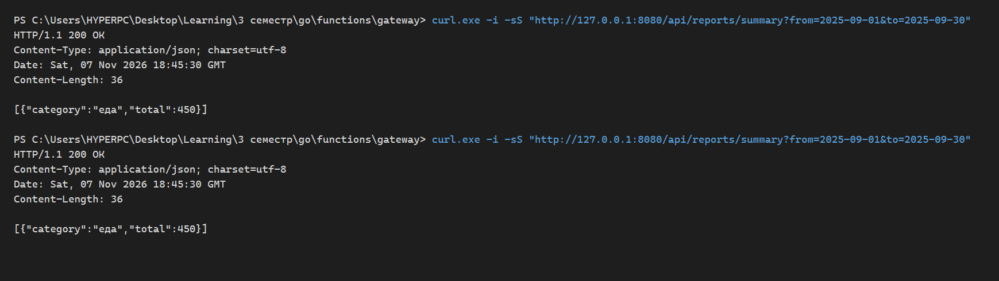

Gateway перезапущен. Ключ `budgets:all` перед чтением удалён из Redis, в журнале `cache miss`:

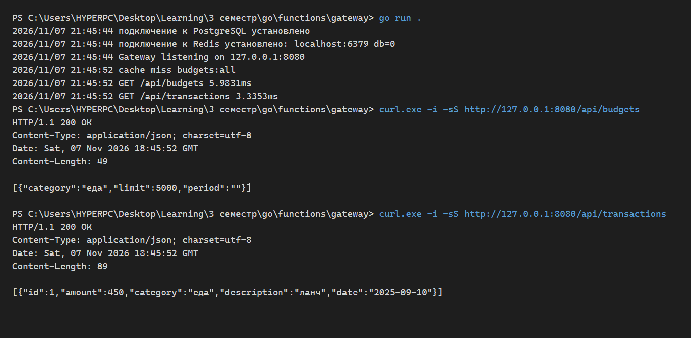

# Домашнее задание 8

Ledger разложен по слоям. `internal/domain` описывает сущности и интерфейсы хранилища. `internal/repository/pg` содержит SQL. `service` выполняет `Validate` и правило бюджета и ходит в базу только через эти интерфейсы. `app.New(ctx)` открывает PostgreSQL, собирает репозитории и возвращает сервис вместе с `closeFn`. Gateway вызывает фабрику, передаёт сервис в `api.New` и закрывает ресурсы через `defer closeFn()`. Пакеты `service` и `app` стоят вне `internal`, потому что Gateway — отдельный модуль.

`go test ./... -count=1 -v` при `DATABASE_URL` и `REDIS_ADDR`. Табличные проверки `Validate` идут с `t.Parallel()`. Сумма сверх лимита не попадает в список. HTTP-сценарии `ok`, `exceeded`, `bad_json` и `bad_limit` сохраняют прежние коды.

Ledger:

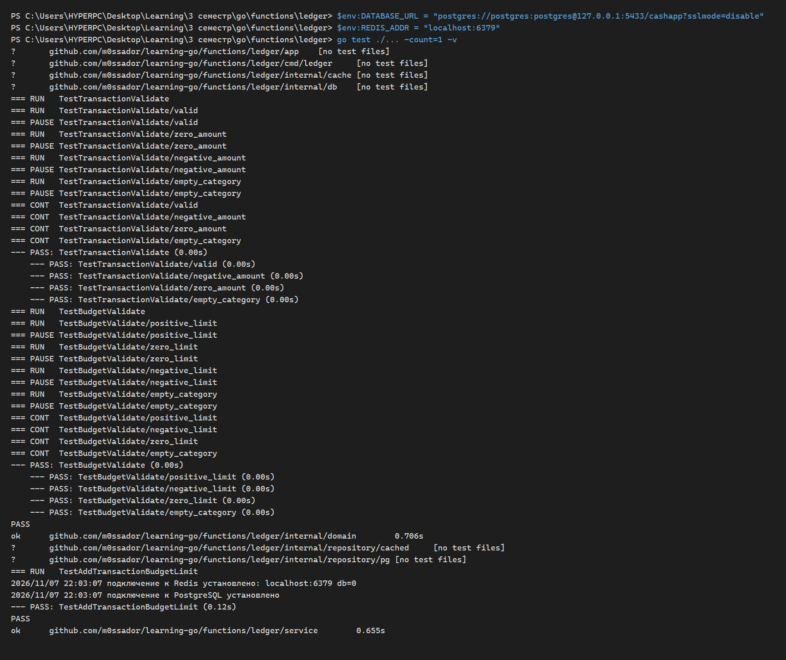

Gateway:

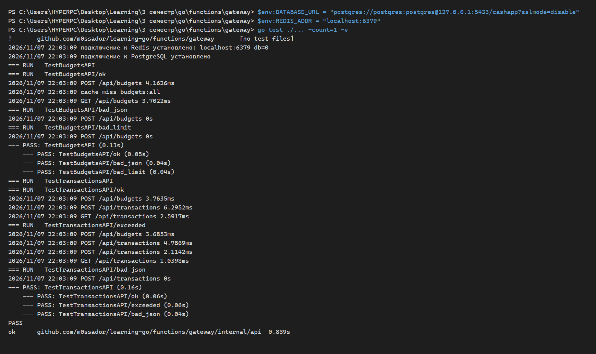

Пустые списки, бюджет «еда» 5000, нулевой лимит и неверный JSON:

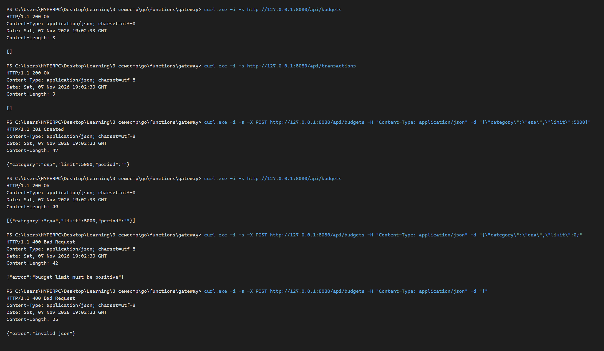

Расход 450, отказ `409` на сумму сверх лимита:

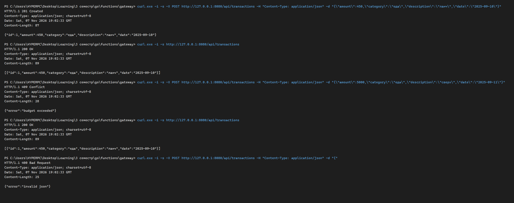